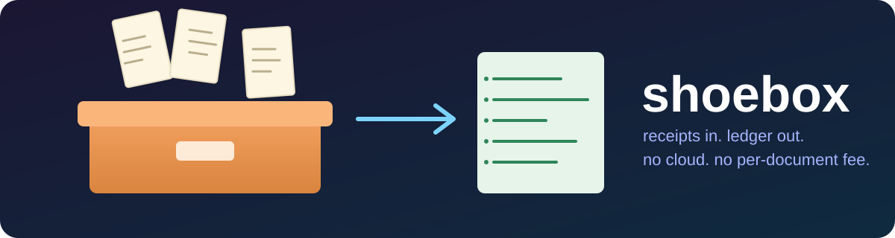
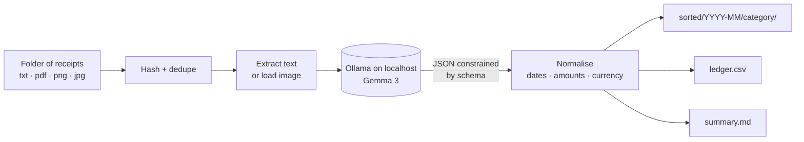

<p align="center">
  
</p>

<p align="center">
  
  
  
  
  
  
</p>

# 🥿 Shoebox

**A receipt and invoice sorter for freelancers that runs on your laptop.**
Point it at a messy folder. It reads every receipt with an open-weight model, files each one by month and category, and hands you a CSV and a tax-time summary. Client data never leaves your machine.

Built for the *Hacktoberfest Open-Source AI Challenge, Week 2: Side Hustle*.

> **Honest status:** this is a first-draft prototype. It was written without being run, so expect rough edges. Nothing here has been tested against a real model yet, and it has no users yet. The steps below are how you check it.

---

## The side hustle

Every freelancer has a shoebox (or a `Downloads` folder) full of receipts, and every quarter they lose an afternoon to it. That afternoon is worth paying to skip.

| Who pays | What they pay for | Why local matters |
|---|---|---|
| Freelancers and solo consultants | A quarterly "tax pack": sorted folders, `ledger.csv`, `summary.md` | Client names, rates and invoices stay on their laptop |
| Bookkeepers with many small clients | A one-time setup plus a per-client scan service | No per-document API bill eating the margin |
| Small shops and studios | A shared-drive version running on a spare mini PC | Nothing to put in a privacy policy |

### Why open innovation is the point

- **Cost:** a cloud vision API charges per page. Here the marginal cost of the 5,000th receipt is the electricity. That is what makes a flat-price service viable.
- **Privacy:** invoices carry client names, rates and bank details. Sending those to a third party is a hard sell. With Ollama the request goes to `localhost`.
- **No lock-in:** the model is one flag (`--model`). Swap Gemma for any other model Ollama serves, or fine-tune one on your own country's receipt formats.
- **Offline:** works on a train, in a café with bad wifi, or in an air-gapped office.

## How it works



1. **Hash and dedupe.** Each file's SHA-256 goes in `ledger.json`, so re-running only reads new files.
2. **Read.** Text goes to the model as text. Photos go as images to a vision-capable model.
3. **Constrained output.** Ollama's `format` field takes a JSON schema, so the model must answer in a fixed shape with a fixed list of categories.
4. **Don't trust the model.** `schema.py` re-parses every date and amount (`$1,234.50`, `1.234,50 €`, `09/03/2026`) and falls back to safe defaults. Anything missing a date or total is listed under *Needs a human look*.
5. **File it.** Copies (or moves, with `--move`) into `sorted/2026-03/travel/2026-03-09_delta-air-lines_304.00.txt`.

Totals are kept **per currency**. Shoebox never converts, because guessing an exchange rate is how books go wrong.

## Try it yourself

You need [Ollama](https://ollama.com) and Python 3.9+. Shoebox itself has zero runtime dependencies.

```bash
# 1. get the code
git clone https://github.com/amandewatnitrr/shoebox.git
cd shoebox

# 2. get a model (one-time download, several GB)
ollama pull gemma3:4b

# 3. check everything is wired up
python -m shoebox doctor

# 4. sort the bundled sample receipts
python -m shoebox scan examples/sample_receipts --out shoebox-out

# 5. look at the result
cat shoebox-out/summary.md
open shoebox-out/ledger.csv
```

Optional extras:

```bash
pip install -e .            # installs the `shoebox` command
pip install -e '.[pdf]'     # adds PDF text support (pypdf)
shoebox scan ~/Downloads/receipts --dry-run      # preview, changes nothing
shoebox scan ~/Downloads/receipts --move         # move instead of copy
shoebox scan ./scans --model gemma3:12b          # a bigger model reads photos better
shoebox report --out shoebox-out                 # rebuild CSV and summary from ledger.json
```

Run the unit tests (they never touch a model):

```bash
python -m unittest discover -s tests -v
```

### What you should see

For the four sample files, expect roughly:

```
shoebox-out/
├── ledger.csv
├── ledger.json
├── summary.md
└── sorted/
    ├── 2026-02/software/2026-02-14_figma_15.00.txt
    ├── 2026-03/meals/2026-03-11_cafe-luna_27.50.txt
    ├── 2026-03/professional-services/…  (or "software", the model decides)
    └── 2026-03/travel/2026-03-09_delta-air-lines_304.00.txt
```

A small model can mislabel a category. That is why the summary flags what it is unsure about and why the original files are copied, not moved, by default.

## Layout

| File | Job |
|---|---|
| `shoebox/cli.py` | `doctor`, `scan`, `report` commands |
| `shoebox/scan.py` | walk folder, skip known hashes, drive the pipeline |
| `shoebox/reader.py` | prompt + one retry on malformed JSON |
| `shoebox/ollama.py` | tiny stdlib client for the local Ollama API |
| `shoebox/extract.py` | text, image and PDF loading |
| `shoebox/schema.py` | the JSON schema and tolerant parsers |
| `shoebox/sorter.py` | folder layout and collision-safe copy |
| `shoebox/ledger.py` | `ledger.json`, CSV, markdown summary |
| `tests/` | pure-Python unit tests, no model required |

## Known limits

- Scanned PDFs with no text layer are rejected with a hint to export them as images.
- Tiny models misread blurry photos. Use a larger vision model for those.
- Not tax advice. Check anything you file.
- One document per file. Multi-receipt scans are not split.

## Roadmap

- [ ] Fine-tuned category model per country
- [ ] Watch-folder mode for a spare mini PC
- [ ] Per-client tagging for bookkeepers
- [ ] Export to common accounting import formats
- [ ] Land a first paying user and write down what they ask for next

## License

MIT. See [LICENSE](LICENSE).
